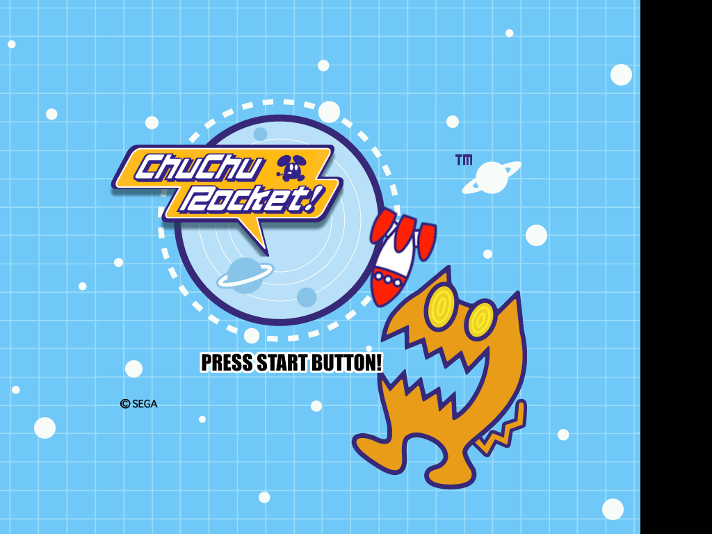
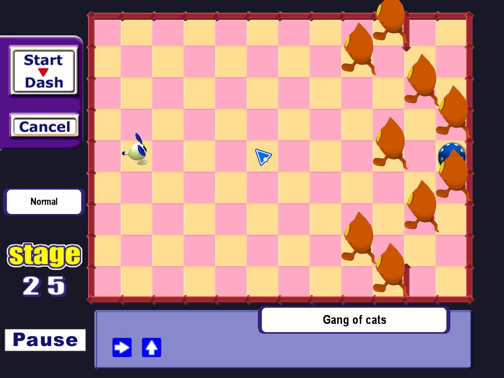
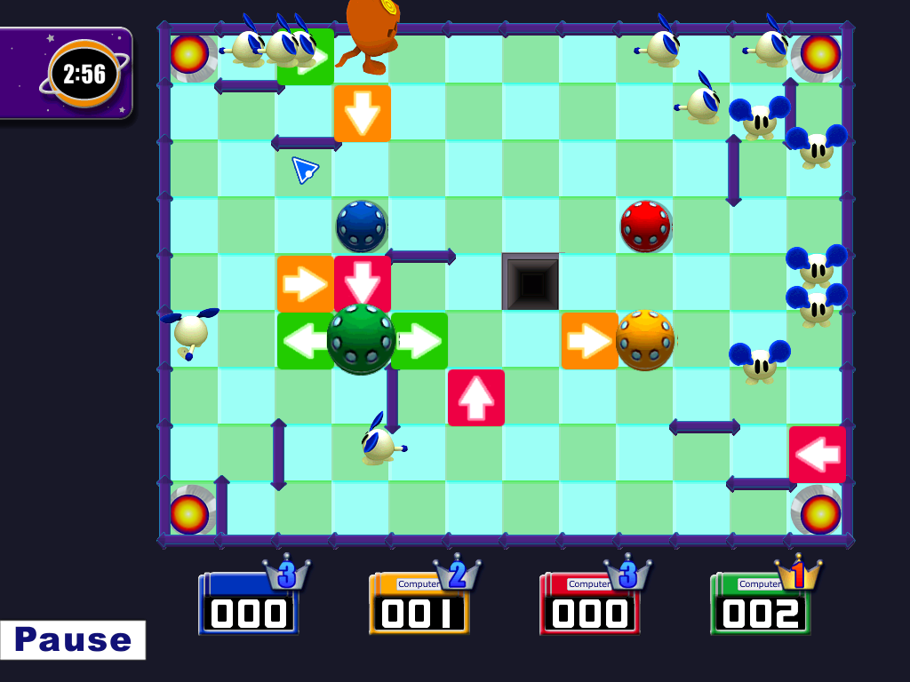

# ChuChu Rocket! Re-Nyastered

Start with your own supported copy of ChuChu Rocket! The tested USA Dreamcast CUE/BIN image alone can supply playable assets; no mobile files or BIOS are required. Supported iOS, Android, GBA and Dreamcast Express files provide other assets and content. Use the containing folder in RecompLauncher's Easy Setup, or follow [Windows build and setup](#build-and-setup-windows) from a checkout. Pre-built releases contain the program and setup tools, with no game files: extract one, run `ccr.exe --prepare` with the folder that holds your originals (or let RecompLauncher do it), then start `ccr.exe`. Setup accepts a folder or a selected `.gdi`/`.cue` descriptor; keep every referenced raw track beside it.

**Latest progress preview:** [v2026.11.21-preview.1 — Windows, Linux and macOS](https://github.com/TideGear/ChuChu-Rocket-Re-Nyastered/releases/tag/v2026.11.21-preview.1). This adds native Dreamcast Puzzle selection and clear-result controls and fixes cursor atlas bleeding. Dreamcast sound effects and the Puzzle shuttle launch are still unfinished. Rerun Easy Setup after updating to regenerate the new UI assets.

**This is a fully human-driven, AI-powered reimplementation of SEGA's ChuChu Rocket!** I direct the project and set the standard for accepting changes. AI assists with reverse engineering, implementation, testing and documentation. When a feature is verified against an original release, the documentation shows how the comparison ran and which cases it covered.

### Work-in-progress screenshots



| Puzzle | Battle |
| --- | --- |
|  |  |

**This is very much a work in progress.** These are earlier development captures; the latest preview prefers native Dreamcast presentation when disc assets are available. Menus, visuals, and gameplay continue to change as more of the original releases are reproduced and verified.

> **Unofficial fan project.** This project has no affiliation with SEGA. The artwork shown in the screenshots, along with the original games’ music, stages and marks, belongs to the respective rights holders. Use your own lawfully obtained game files to generate the assets required to play. See [asset handling and release notes](docs/distribution.md).

The project brings together the strongest parts of the Dreamcast, Game Boy Advance, iOS and Android releases in a portable C++ and SDL2 implementation. The current build prefers Dreamcast models and disc UI where implemented, with version-specific presentation and content still being completed. Each [asset and rule source](docs/provenance.md) is documented separately.

[Build and play](#build-and-setup-windows) · [Original files needed by mode](#which-original-files-do-i-need) · [Status and plan](#status-and-plan) · [Verification results](docs/verification.md)

## Status and plan

**Playable now on Windows:** Puzzle with stage select, Battle with local hotseat for up to four players on one machine and CPU opponents, Stage Challenge (24 of 25 stages; the last, a one-minute roulette battle, matches the original on two of three recorded seeds and to frame 2779 of 4070 on the third), the title and main menu, Help & Options with a Settings page (display, log detail, controller button remapping, Battle CPU style), and a portable data mode.

**Planned multiplayer:** Wireless local play via mobile devices and online play.

The goal is a faithful Windows, Android arm64 and web reimplementation. Each phase compares the originals’ code, data, and runtime behavior with the port. The roadmap records verified cases and gaps, including alternate routes, rare events, and asset fallbacks.

| Phase | What’s in place | What’s planned |
| --- | --- | --- |
| **A. Original presentation and UI** | iPad startup logos, title and menus, Puzzle stage select, parts of both HUDs, pause, Battle round banners, and animated backgrounds. With the iPad assets, the Battle menu opens Players and Settings and launches local shared-screen matches on all 25 boards. | Finish split-screen setup, previews and locks, HUDs and results, The Basics and Options, and the remaining roulette, character, rocket and cursor effects. Verify timing, draw order, depth ties, overlaps, wall joins and clipping against the original. |
| **B. Rule parity** | Puzzle movement matches the 2,548 tested mobile stages. Mobile battle scoring, roulette selection and CPU placement have separate comparisons. Whole-battle comparison against the original's real loop (including its roulette freeze) is identical for 26 of 26 recorded battles for each of the eight forced roulette outcomes in free-for-all; Stage Challenge stages 1-24 are ported and compared; Puzzle Edit's board conversion and CRC are ported. | Team Battle through the real loop, per-rank thresholds, the last Challenge stage on every seed, Challenge and Team Battle result screens, and Puzzle Edit (screen, original rules, file export including Dreamcast .VMS/.VMI). |
| **C. Version differences** | Dreamcast input and speed, scoring, roulette and parts of the CPU task are documented or compared. GBA puzzle stage 1 and individual CPU routines have ROM comparisons. Several iOS releases have their own runs. | Verify Dreamcast heat maps and full-battle CPU placement, determine Dreamcast effect playback rates, match GBA battle rules and full CPU placement, explain the GBA score gap, and cover remaining iOS-specific differences. |
| **D. Content and options** | Asset extractors and a cross-version stage registry exist. The current build can play the main puzzles, GBA extras and the Dreamcast Express set with the corresponding exports. Some sound and language options work. | Verify original unlocks and options, add unlock-all, import DLC skins and VMU saves, determine PuzzleP arrow stock, and make every stage set selectable. |
| **E. Audio, animation and assets** | Dreamcast CD music is preferred when available. Mobile files supply effects and voices. Some triggers, effects and animations have original-runtime comparisons. Dreamcast models are extracted and render offline. | Audit every sound, voice, song, animation and effect across versions, including indirect triggers, timing and cancellation. Verify loops and fades, document source quality, and integrate the Dreamcast models into live play. |
| **F. Platforms and play** | Windows build, fixed 60 Hz simulation with interpolation, headless 2D GPU measurements at 4K, local hotseat for up to four players, controller remapping with a hold-to-quit combo, and headless WebAssembly runs. Deterministic replays and loopback UDP lockstep have been tested. | Verify sustained and uncapped 4K performance as rendering is completed, implement wireless local play via mobile devices and online play, build and test the Android arm64 app, and finish the web app’s asset import and PWA checks in a headless browser and on iOS Safari. |
| **G. Documentation and setup** | Cross-version matrix, asset provenance, original-file requirements, and a portable Zig build. Setup unpacks originals and records their hashes. Versioned Windows releases with checksums, portable mode (`portable.txt`), a commented `settings.ini` and `controls.ini`, and a rotating gameplay log. | Linux and macOS builds (only a compile check so far), complete the evidence and provenance for each version, automate the remaining asset exports, and verify the full setup-to-play process on a clean machine. |

See the [roadmap and dated work log](docs/roadmap.md), [verification results](docs/verification.md), [per-version matrix](docs/version_matrix.md) for the evidence behind each row, and the [requirement audit](docs/audit.md) for the current status of every goal requirement and every claim in the version-comparison document.

## Build and setup (Windows)

1. Put your [original game files](#which-original-files-do-i-need) in `Original Game Files` beside `setup.cmd`, then run `setup.cmd` from the checkout. If that folder is absent, setup asks for the path. To specify both paths directly from PowerShell, run `.\setup.cmd -GameFiles 'D:\My Game Files' -Cache 'D:\ChuChuRocketReNyastered'` (or set `-GameFiles` to a selected `.gdi`/`.cue` descriptor with its raw tracks beside it).
2. Setup uses Python 3.10 or later if it can import Pillow. Otherwise it downloads and verifies private copies of Python 3.12.10 and Pillow 12.2.0 and caches them in `local\tools\windows`. Setup extracts into `%APPDATA%\ChuChuRocketReNyastered\assets` by default and writes `manifest.json` and `setup.log` beside `assets`.
3. Setup builds `build\game\ccr.exe`. The first build downloads and verifies portable Zig 0.14.1, CMake 4.0.3, Ninja 1.12.1, SDL2 2.30.9 and `stb_vorbis.c`. It uses the checkout's `local\tools\windows` and `build\game-zig` folders. Visual Studio C++ Build Tools are unnecessary.
4. Launch `build\game\ccr.exe`. Setup reports which modes are playable from the files in your cache. Pass the `assets` folder as the first argument or set `CCR_ASSETS` if you use a custom cache.

Run `build.cmd --target ccr` to rebuild only the game. For an offline build, set `CCR_TOOL_ARCHIVES` to a folder containing `zig.zip`, `cmake.zip`, `ninja.zip`, `SDL2-2.30.9.tar.gz` and `stb_vorbis.c`. For offline extraction without an existing Python and Pillow installation, include `python-3.12.10-embed-amd64.zip` and `pillow-12.2.0-cp312-cp312-win_amd64.whl` too. The pinned URLs and hashes are in the [build script](tools/build-windows.ps1), [Python setup script](tools/setup-python.ps1), and [CMake configuration](game/CMakeLists.txt).

**Optional Dreamcast BIOS font.** The Dreamcast game draws some text (Challenge select times, Puzzle hints) with its console's built-in ROM font, which is not on the disc and is not distributed here. If you place your own 2 MiB Dreamcast BIOS dump (for example `dc_boot.bin`) in the folder you give to setup, extraction reads those glyphs locally to match the original; if you select a `.gdi` or `.cue` directly, place the BIOS beside that descriptor. Without it the port uses a close substitute.

**Saves, settings and logs.** By default saves (`progress.bin`, `challenge.bin`, `options.bin`), `settings.ini` and `logs/` live in the extracted asset folder. For a portable install put an empty `portable.txt` beside `ccr.exe` (or start with `--portable`, or set `CCR_PORTABLE=1`): everything then lives in a `data` folder beside the program. `settings.ini` is created with comments on first start (fullscreen, vsync, scaling filter, window size, log detail); environment variables and launcher options override it. **Importing Dreamcast puzzle packs.** Put `.VMS` puzzle packs (for example `DEPuzzle.VMS` or `PuzzleP.VMS`; a paired `.VMI` is not needed) in the `imports` folder inside the data folder; they appear as the "Imported Packs" set (Tab in stage select). Character packs and damaged files are skipped.

`logs/ccr.log` rotates by size (`ccr.1.log`, `ccr.2.log`, ...) and records sessions and, at `log_level = 2`, every screen change.

**Unlock all.** Options > Settings has an "Unlock all" row (`unlock_all` in `settings.ini`): it opens every puzzle group without clearing the stages before it, as the original opens them only in order.

**Controller.** In local Battle, press a button on each controller in player order to claim the next available human slot. If a controller disconnects, press a button on a replacement to reclaim the open slot. Button assignments live in `controls.ini` beside `settings.ini`. Hold Back + Start for two seconds to quit with the default bindings.

Runtime options include `CCR_CPU=gba` for GBA-style battle AI (also the `cpu_style` setting and a row on the Options Settings page), `CCR_LANG=en|fr|de|es|it`, `CCR_HUMANS=1..4` (quick-start launches only; the Battle setup screen chooses players), `CCR_SIZE=3840x2160` and `CCR_FULLSCREEN=1`. Use `CCR_HEADLESS`, `CCR_SHOT` or `CCR_BENCH` for silent runs without a visible window. The C++ tests are CMake targets in `game/`, including `determinism_test`, `battle_full_test`, `cpu_test` and `netplay_test`.

Other platforms: the Android NDK build produces arm64 core test executables. The full Android app and emulator run are pending. The WebAssembly app builds with Emscripten, and browser installation and offline startup are still pending. See the [platform audit](docs/audit.md#f-platforms-controls-play) for verification status.

**Installing from a release (Windows, Linux, macOS).** `setup.cmd` is only for a source checkout; release users do not need it. Download the file for your system from the [releases page](https://github.com/TideGear/ChuChu-Rocket-Re-Nyastered/releases) (`...-windows-x64.zip`, `...-linux-x64.tar.gz`, `...-macos-arm64.tar.gz` or `...-macos-x64.tar.gz`), extract it, then either use RecompLauncher (Easy Setup: pick the **folder** that holds your original files) or run `ccr --prepare "<that folder or .gdi/.cue file>"` once (a selected file uses its containing folder) and start `ccr`. Setup needs Python 3.10+ with Pillow. On Windows it can download both. On Linux and macOS it installs Pillow into a private environment in the data folder when `--download-python` is given (RecompLauncher's "Download Python and Pillow if needed" option, on by default), which needs `python3-venv` (Debian/Ubuntu: `sudo apt install python3 python3-venv`) and internet; or install your distribution's `python3-pil` / `python-pillow` yourself. The data folder is `~/.config/ChuChuRocketReNyastered` (`~/Library/Application Support/...` on macOS); setup writes `setup.log` there. Linux x64 and macOS builds are produced and tested by CI and the Linux build was run on Ubuntu 24.04, but they have had little testing on real desktops, so please report problems with `setup.log`. Disc images: numbered `.bin` tracks with their `.cue`, and `.gdi` descriptors with their referenced raw tracks, are accepted. CHD images are not yet supported and are reported during setup; convert CHD to GDI/raw tracks first.

### Which original files do I need?

**Dreamcast image alone is enough to build and play.** The tested USA CUE/BIN image supplies the 100 main puzzles, all 25 Battle boards, Stage Challenge, Dreamcast models, title/menu art, CD music and sound effects. No mobile release, GBA ROM or BIOS is required. Run setup with the folder containing the image tracks or select its `.gdi`/`.cue` descriptor directly; keep every referenced raw track beside it. A fresh cache is recommended when checking an isolated input combination.

**Mobile files are optional additions.** iPad HD 1.0, iPhone 1.0, 1.0.2, 1.1, iOS 1.1.2, and Android 1.14 or 1.15 supply alternate gameplay art and menus/HUDs, depending on release. With Dreamcast input present, setup retains Dreamcast models and CD audio while preferring supported mobile graphics. A GBA ROM adds puzzles; `DEPuzzle.VMS` adds the 25 Dreamcast Express puzzles. A user-supplied BIOS is optional and only improves a few built-in font glyphs. CHD images are not yet supported; setup reports them and accepts GDI/CUE plus referenced raw tracks.

Put whichever originals you have under `Original Game Files` beside `setup.cmd`, or pass your own folder to setup. Subfolders are optional. Setup searches recursively and accepts loose files or ZIPs, including an enclosing ZIP around a package. Keep the numbered files of each Dreamcast dump together in their own folder or ZIP. Use a fresh cache if you want to test a different file combination in isolation.

| Original | Accepted input | What it adds |
| --- | --- | --- |
| **iOS 1.1 or 1.1.2** | `.ipa` or unpacked `.app`, loose or in a ZIP | Either release supplies Retina gameplay art, mobile audio and both playable modes on its own. |
| **iPad ChuChu Rocket! HD 1.0** | `.ipa` or unpacked `.app`, loose or in a ZIP | Supplies both playable modes, iPad gameplay art, mobile audio, menus, layouts, fonts and startup artwork. |
| **iPhone iOS 1.0 or 1.0.2** | `.ipa` or unpacked `.app`, loose or in a ZIP | Either release supplies phone gameplay art, mobile audio and both playable modes on its own. |
| **Android 1.14 or 1.15** | `.apk` or unpacked APK folder, loose or in a ZIP | Either release supplies phone gameplay art, title and menu art, mobile audio and both playable modes on its own. |
| **Game Boy Advance** | `.gba`, loose or in a ZIP | 2,466 additional puzzles and the GBA versions of the 100 main puzzles, including two board variants. Setup uses the GBA main set when available. Tab in stage select cycles available sets. |
| **Dreamcast** | `.gdi` plus every referenced raw track, numbered `.bin` tracks and their `.cue`, or a GD-ROM `.chd` (MAME CHD v5), loose or in a ZIP | Provides the original 100 main puzzles, 25 Battle boards, stereo CD music and original Dreamcast art. A direct setup/launcher selection can be the `.gdi`, `.cue` or `.chd` file itself; keep a descriptor's referenced tracks beside it. |
| **Dreamcast VMU DLC** | `.VMS` with its optional paired `.VMI`, loose or in a ZIP | `DEPuzzle` adds 25 playable Express puzzles. Setup also collects the `PuzzleP`, `Cartoony`, `DEChar` and `UFOCow` saves for future support. |

For Dreamcast, a dump whose track checksums match the **USA multilingual ChuChu Rocket!** entry in [Redump.org](https://redump.org/) and contains **19 raw tracks and one descriptor** is the tested layout. GDI and separate-file CUE descriptors use the referenced raw files and must keep them beside the descriptor (or under a safe relative path). The tested CUE uses raw BINARY audio and MODE1 tracks; other modes/directives/layouts are reported rather than guessed. Selecting the `.gdi` or `.cue` directly in Windows setup is supported. A `.chd` made by `chdman createcd` from a GDI (default codecs cdlz/cdzl/cdfl) is decoded by setup itself and checked against the CHD's own SHA-1 and the disc's sector addresses before use; zstd-compressed (cdzs), parent/delta and pre-v5 CHDs are reported with how to recompress them. CHD decoding is in pure Python, so CD music takes a few extra minutes the first time. CHD support has synthetic and codec tests but has not yet been run on a real ChuChu Rocket! CHD.

### What if I have fewer releases?

- **Phone-only setups** use the available menu and gameplay art. Some HUD panels and effects still require the iPad assets. In Puzzle, use Space or the controller's Start button to run the puzzle.
- **Dreamcast only** supplies the 100 main puzzles, 25 Battle boards, 25 Challenge boards, and original models, textures and music. A fresh Windows build and setup from the USA CUE/BIN tracks produced playable Puzzle, Battle, Team Battle and Challenge headless runs without mobile files. The disc-only interface uses original Mode Select and Challenge selection art. See the [audit](docs/audit.md) for remaining presentation and platform gaps.
- **Game Boy Advance only** supplies puzzles. A GBA graphics path is still needed for standalone play.
- **All four platforms shipped Battle.** The old Dreamcast requirement came from the stage exporter. Setup now recognizes the byte-identical mobile Battle maps. The GBA Battle boards are still outside the stage importer. `CCR_CPU=gba` enables the port's GBA-style AI with any exported Battle boards and needs no GBA ROM. [Stage format notes](docs/stages.md)
- **Missing optional files** reduce the available art, music or stage sets. The mobile Ogg soundtrack plays if Dreamcast CD tracks are absent. In the mobile look, the port uses the iPad assets when available, then the Android phone art. With neither set, it opens a simple Puzzle and Battle menu.

### Dreamcast look or mobile look

Setup works with a Dreamcast image alone, with mobile releases alone, or with both. When both are set up, three settings choose what you see and hear. Each is a row in Options > Settings (on the Dreamcast look, Options > Re-Nyastered Settings), a line in `settings.ini`, and a RecompLauncher setting:

| Setting | Choices | Default |
|---|---|---|
| Look (`presentation`) | `dreamcast`: the disc's startup, Mode Select, Options, Help, HUDs, cursors and pause screens. `mobile`: the iPad/iPhone/Android screens and HUDs. | `auto`: Dreamcast when its files were set up, otherwise mobile. |
| Sound (`sound_source`) | `dreamcast`: CD tracks and the original sound effects. `mobile`: the iOS/Android music and effects. | `auto`: Dreamcast first; mobile fills any gaps. |
| 3D characters (`models_3d`) | With the mobile look, draws cats, mice, rockets and boards with the Dreamcast 3D models. The Dreamcast look always uses them. | On, when a Dreamcast image was set up. |

If you choose a look whose files were not set up, the game uses the other one and says so in the setting's label.

### Launching a mode directly

The core gameplay exports are automatic. To refresh your cache, rerun setup. To launch a specific mode directly, pass the mode after the asset cache path.

```powershell
$assets = Join-Path $env:APPDATA 'ChuChuRocketReNyastered\assets'
.\build\game\ccr.exe "$assets" puzzle
.\build\game\ccr.exe "$assets" battle
.\build\game\ccr.exe "$assets" challenge 4   # Stage Challenge; the stage number is optional
```

In Puzzle and Battle, aim with the mouse and press **WASD** or the **arrow keys** to place an arrow in the hovered cell. Mouse dragging also places arrows. On a controller, move with the left stick or D-pad and use the four face buttons in their directional positions, as on Dreamcast (rebind them in `controls.ini` or Options > Settings).

The default launch plays the iPad startup logos when available. Pass `title` to skip the logos. If you supply a Dreamcast disc, setup also exports its title logo and Start prompt for the desktop build.

When setup exports a Dreamcast model pack, the 3D characters and board art are on by default. With the mobile look you can turn them off in Options > Settings or set `models_3d = false` in `settings.ini`.

The [presentation audit](docs/presentation_audit.md) tracks missing startup screens, effects, and animation. Dreamcast-only setup supplies the live board models, character meshes, and disc UI sheets. The [Dreamcast rendering notes](docs/dreamcast_models.md) document the Flycast comparisons and remaining gaps.

## Where each asset and rule comes from
[docs/provenance.md](docs/provenance.md) lists, per asset class and per piece, the version used and the measurements behind the choice (music: Dreamcast CD audio; title logo: Dreamcast; backgrounds and sprites: iPad HD pack; strings: Android resources; rules: each version's own code). [docs/version_matrix.md](docs/version_matrix.md) compares every subsystem across all versions.

## Layout
- `game/` C++ code: portable simulation core (`core/`), the SDL2 app (`app/`), tests (`tests/`), web shell (`web/`)
- `tools/` extractors, the stage registry, and the development-time verification oracles (`tools/oracle/`: your own copies of the original code run in emulators; nothing from them is distributed)
- `docs/` rules specification, verification results, version comparisons, provenance, UI art notes, known gaps
